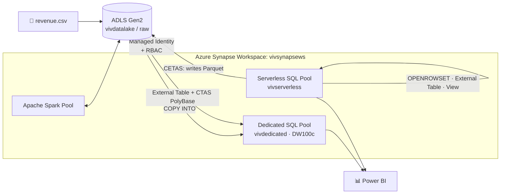
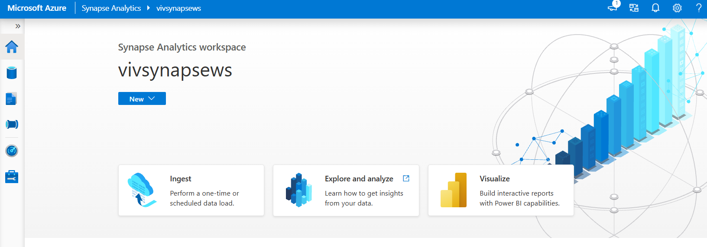
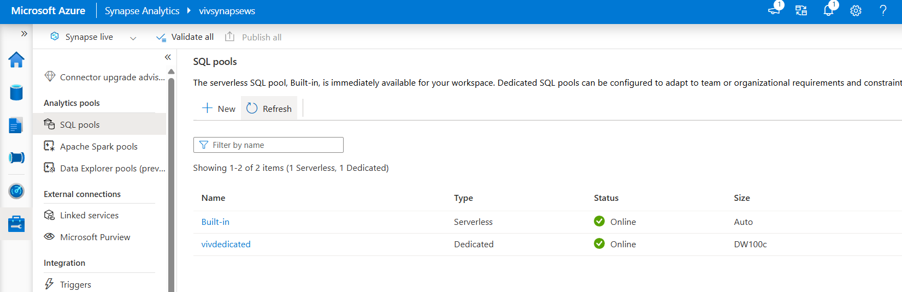
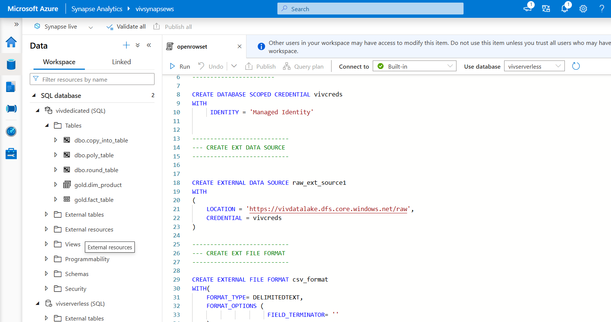
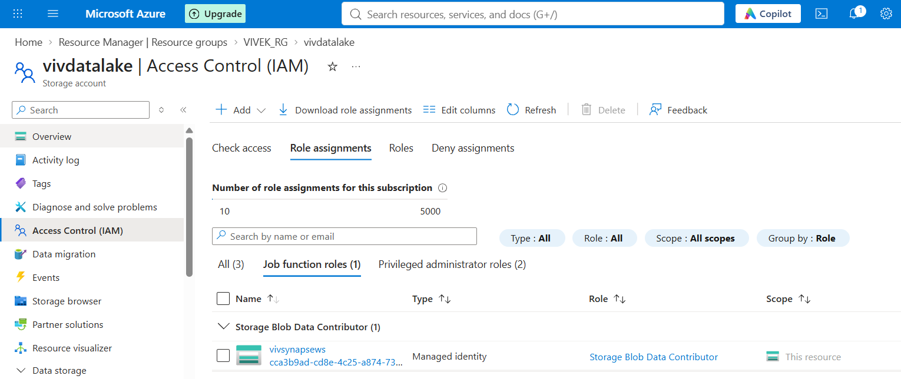
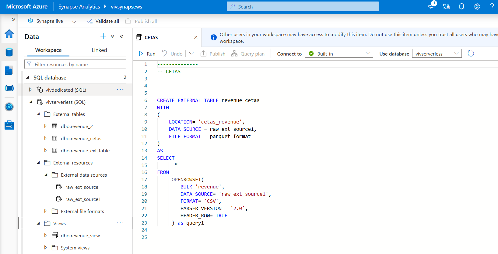

# ☁️ Azure Synapse Analytics: Hands-On Data Warehouse & Lakehouse Project

**A practical, end-to-end implementation of Azure Synapse Analytics: dedicated SQL pool, serverless SQL pool, data lake integration, and data loading patterns.**


---

## 📌 About the Project

This repository documents my hands-on journey of building a **modern data platform on Azure Synapse Analytics**. Starting from an empty subscription, I provisioned the infrastructure, designed distributed tables on an **MPP data warehouse**, connected an external **Data Lake (ADLS Gen2)** with **passwordless security**, queried raw files using **serverless SQL**, and loaded data into the warehouse using both **`COPY INTO`** and **CTAS (PolyBase)**.

> 🎯 **Goal:** understand not just *how* to run the commands, but *why* each design decision matters: distribution strategy, security model, cost, and performance.

**Dataset:** `revenue.csv`, an automotive sales dataset with columns `Dealer_ID, Model_ID, Branch_ID, Date_ID, Units_Sold, Revenue`.

---

## ✨ What I Built (Highlights)

| ✅ | Achievement |
|---|---|
| 🏗️ | Provisioned a **Synapse workspace** with a Data Lake Gen2 account inside a dedicated resource group |
| 🧱 | Created a **Dedicated SQL Pool (DW100c)** and designed **Round Robin, Replicated and Hash** distributed tables |
| 🔐 | Secured data-lake access using **System-assigned Managed Identity + Azure RBAC** (no keys, no passwords in code) |
| 🔍 | Queried CSV files in the lake using **serverless SQL**: `OPENROWSET`, **External Tables**, **Views** |
| 📤 | Wrote data back to the lake as **Parquet** using **CETAS** |
| 📥 | Loaded data into the warehouse using **`COPY INTO`** and **CTAS with PolyBase external tables** |
| ⚡ | Explored **Apache Spark pools** for big-data transformations |
| 🧪 | Reproduced and resolved a real error: *external table location does not exist* |

---

## 🏛️ Architecture



**Medallion-style layout used in the warehouse:** `dbo` (staging) → `gold` (curated star schema).

---

## 🧾 Azure Resources

```
Subscription
└── 📦 Resource Group: VIVEK_RG
    ├── 🗄️ Storage Account (ADLS Gen2) : vivdatalake            ← business data lake
    │      └── raw/ (container)
    │            ├── revenue/revenue.csv                         ← source file
    │            └── cetas_revenue/*.parquet                     ← output of CETAS
    └── 🔷 Synapse Workspace            : vivsynapsews
           ├── Primary storage          : manstoragesynapseviv (file system: manfssynapseviv)
           ├── Dedicated SQL pool       : vivdedicated  (DW100c)
           ├── Serverless database      : vivserverless
           └── Spark pool               : (configured for transformations)
```

> 💡 **Why two storage accounts?** `manstoragesynapseviv` is the workspace's *default* storage (Spark data, pipeline staging, logs). `vivdatalake` is the *business* data lake I attached as an external source, which keeps system and business data separate for cleaner security and cost tracking.

---

## 📚 Core Concepts (Short Theory)

### What is Azure Synapse Analytics?
A unified analytics platform that combines **data warehousing, big-data processing (Spark), data integration (pipelines) and BI integration** in one workspace (Synapse Studio). It evolved from **Azure SQL Data Warehouse** (rebranded in 2019), which itself descends from Microsoft's **Parallel Data Warehouse (MPP)** technology.

### Architecture at a glance

| Component | Role |
|---|---|
| **Control node** | The "brain": single entry point; receives T-SQL, optimizes it, splits it into parallel work |
| **Compute nodes** | The "muscle": run the parallel queries (1–60 nodes in a dedicated pool) |
| **Data Movement Service (DMS)** | Moves data between compute nodes when a query needs it |
| **Azure Storage** | Holds the data; **storage and compute are decoupled** |
| **Distributions** | A dedicated pool always splits data into **60 distributions**, the basic unit of parallelism |



### Dedicated vs Serverless SQL pool

| | **Dedicated SQL Pool** | **Serverless SQL Pool** |
|---|---|---|
| Model | Provisioned (DWU) | On-demand, auto-scaling |
| Billing | Per hour while running (pausable) | Per TB of data processed |
| Data location | Inside tables in the pool | Stays in the data lake |
| Write support | Full DML | Read-only (writes only via CETAS) |
| Best for | Enterprise reporting, high concurrency | Exploration, logical data warehouse |



### Table distribution types (dedicated pool)

| Type | How rows are placed | Best for |
|---|---|---|
| **ROUND_ROBIN** | Evenly, in sequence | Staging / load tables |
| **HASH(col)** | Deterministic hash of a column value | Large **fact** tables |
| **REPLICATE** | Full copy on every compute node | Small **dimension** tables (< ~2 GB) |

> ⭐ **Golden rule:** *Facts = HASH · Dimensions = REPLICATE · Staging = ROUND_ROBIN.*

---

## 🛠️ Implementation Walkthrough

### 1. Environment Setup

1. Created resource group **`VIVEK_RG`**.
2. Created storage account **`vivdatalake`** (hierarchical namespace enabled → ADLS Gen2).
3. Created the Synapse workspace **`vivsynapsews`** with primary account `manstoragesynapseviv` and file system `manfssynapseviv`; configured SQL admin credentials.

---

### 2. Dedicated SQL Pool & Distributed Tables

Created the pool **`vivdedicated`** at the smallest performance level **DW100c** (cheapest way to learn MPP concepts; the data is still split into 60 distributions).

```sql
-- ROUND ROBIN: fastest load, ideal for staging
CREATE TABLE round_table
(
    id     INT,
    name   VARCHAR(4000),
    salary INT
)
WITH ( DISTRIBUTION = ROUND_ROBIN );

-- REPLICATE: small dimension, full copy on every compute node
CREATE SCHEMA gold;

CREATE TABLE gold.dim_product
(
    dim_key_prod INT,
    prod_id      INT,
    prod_name    VARCHAR(4000)
)
WITH ( DISTRIBUTION = REPLICATE );

-- HASH: large fact table, co-located by the join key
CREATE TABLE gold.fact_table
(
    dim_key_prod INT,
    revenue      INT,
    cost         INT
)
WITH ( DISTRIBUTION = HASH(dim_key_prod) );
```

**Design reasoning**

```
 gold.dim_product (REPLICATE) ◄── dim_key_prod ──► gold.fact_table (HASH on dim_key_prod)
```

The fact table is hashed on the **join key** and the dimension is **replicated**, so joining them needs **zero data movement**.

**Verify the distribution yourself:**
```sql
DBCC PDW_SHOWSPACEUSED('dbo.round_table');   -- rows per distribution
SELECT t.name, d.distribution_policy_desc
FROM sys.tables t
JOIN sys.pdw_table_distribution_properties d ON t.object_id = d.object_id;
```



---

### 3. Connecting the Data Lake (Managed Identity)

Instead of storage keys, I used **passwordless authentication**:

1. `vivdatalake` → **Access control (IAM)** → **Add role assignment**
2. Role: **Storage Blob Data Contributor**
3. Assign access to: **Managed identity** → selected workspace **`vivsynapsews`**
4. Uploaded the dataset to `raw/revenue/revenue.csv`

```
Synapse workspace (system-assigned identity) ──RBAC: Storage Blob Data Contributor──► vivdatalake
```

✅ No secrets in code · ✅ Least-privilege · ✅ Auditable



---

### 4. Serverless SQL Pool: Query the Lake with SQL

Created the serverless database **`vivserverless`** and built the objects in the correct order:

```
MASTER KEY → DATABASE SCOPED CREDENTIAL → EXTERNAL DATA SOURCE → EXTERNAL FILE FORMAT
                                                   └──► OPENROWSET | EXTERNAL TABLE | VIEW | CETAS
```

```sql
-- 1) Master key (once per database)
CREATE MASTER KEY ENCRYPTION BY PASSWORD = '<strong-password-stored-in-key-vault>';

-- 2) HOW to authenticate
CREATE DATABASE SCOPED CREDENTIAL vivcreds
WITH IDENTITY = 'Managed Identity';

-- 3) WHERE the data is
CREATE EXTERNAL DATA SOURCE raw_ext_source1
WITH (
    LOCATION   = 'https://vivdatalake.dfs.core.windows.net/raw',
    CREDENTIAL = vivcreds
);

-- 4) WHAT the files look like
CREATE EXTERNAL FILE FORMAT csv_format
WITH (
    FORMAT_TYPE    = DELIMITEDTEXT,
    FORMAT_OPTIONS ( FIELD_TERMINATOR = ',', FIRST_ROW = 2 )
);

CREATE EXTERNAL FILE FORMAT parquet_format
WITH ( FORMAT_TYPE = PARQUET );

-- 5) Query the CSV directly. No loading, no cluster.
SELECT *
FROM OPENROWSET(
        BULK 'revenue',
        DATA_SOURCE   = 'raw_ext_source1',
        FORMAT        = 'CSV',
        PARSER_VERSION= '2.0',
        HEADER_ROW    = TRUE
     ) AS query1;
```

#### 4.1 External Table: a permanent "window" over files
```sql
CREATE EXTERNAL TABLE revenue_ext_table
(
    Dealer_ID  VARCHAR(4000), Model_ID  VARCHAR(4000), Branch_ID VARCHAR(4000),
    Date_ID    VARCHAR(4000), Units_Sold VARCHAR(4000), Revenue  VARCHAR(4000)
)
WITH (
    LOCATION    = 'revenue',
    DATA_SOURCE = raw_ext_source1,
    FILE_FORMAT = csv_format
);

SELECT * FROM revenue_ext_table;
```

#### 4.2 CETAS: Create External Table As Select
Persists query results as **Parquet** in the lake (the only way serverless *writes* data).
```sql
CREATE EXTERNAL TABLE revenue_cetas
WITH (
    LOCATION    = 'cetas_revenue',
    DATA_SOURCE = raw_ext_source1,
    FILE_FORMAT = parquet_format
)
AS
SELECT *
FROM OPENROWSET(
        BULK 'revenue',
        DATA_SOURCE='raw_ext_source1',
        FORMAT='CSV', PARSER_VERSION='2.0', HEADER_ROW=TRUE
     ) AS query1;
```
```
revenue.csv ──read──► SELECT ──write──► cetas_revenue/*.parquet ◄── revenue_cetas
```

#### 4.3 Views: a logical data warehouse layer
```sql
CREATE VIEW revenue_view AS
SELECT *
FROM OPENROWSET(
        BULK 'revenue',
        DATA_SOURCE='raw_ext_source1',
        FORMAT='CSV', PARSER_VERSION='2.0', HEADER_ROW=TRUE
     ) AS query1;

SELECT * FROM revenue_view;
SELECT * FROM revenue_cetas;
```

#### 4.4 Which one should I use?

| | OPENROWSET | External Table | View | CETAS |
|---|:---:|:---:|:---:|:---:|
| Reusable object | ❌ | ✅ | ✅ | ✅ |
| Stores data | ❌ | ❌ | ❌ | ✅ (files) |
| Needs schema | optional | ✅ | optional | from `SELECT` |
| Writes to lake | ❌ | ❌ | ❌ | ✅ |
| Best for | Exploration | Stable schema | BI / abstraction | Persisting results |

#### 4.5 🧪 Experiment: What if the folder doesn't exist?
```sql
CREATE EXTERNAL TABLE revenue_2 ( ... )
WITH ( LOCATION = 'revenue2', DATA_SOURCE = raw_ext_source1, FILE_FORMAT = csv_format );

SELECT * FROM revenue_2;
-- ❌ External table 'revenue_2' is not accessible because location does not exist
--    or it is used by another process.
```

**Finding:** `CREATE EXTERNAL TABLE` only stores metadata, so it succeeds. The path is validated **at read time**. After creating the `revenue2/` folder (and adding files), the query works. An empty folder returns 0 rows.



---

### 5. Loading Data into the Warehouse: `COPY INTO` vs `CTAS`

Serverless leaves data in the lake; the **dedicated pool** needs data **inside its tables** for speed, indexing and concurrency. I implemented both methods.

| | **COPY INTO** | **CTAS + PolyBase external table** |
|---|---|---|
| Steps | 1 statement | External objects + CTAS |
| Setup objects | None | Data source, file format, external table |
| Transform while loading | Minimal | Full SQL (joins, casts, filters) |
| Set distribution/index | Table created first | Defined inside the CTAS |
| Best for | **Fast, simple ingestion** | **ELT transformations** |

#### 5.1 Method 1: `COPY INTO`
```sql
CREATE TABLE copy_into_table
(
    Dealer_ID  VARCHAR(4000),
    Model_ID   VARCHAR(4000),
    Branch_ID  VARCHAR(4000),
    Date_ID    VARCHAR(4000),
    Units_Sold BIGINT,
    Revenue    BIGINT
)
WITH ( DISTRIBUTION = ROUND_ROBIN );

COPY INTO copy_into_table
FROM 'https://vivdatalake.dfs.core.windows.net/raw/cetas_revenue/'
WITH (
    FILE_TYPE  = 'PARQUET',
    CREDENTIAL = (IDENTITY = 'Managed Identity')
);

SELECT * FROM copy_into_table;
```

#### 5.2 Method 2: CTAS (PolyBase)
```sql
-- Step 1: external table (metadata only) over the Parquet files
CREATE EXTERNAL TABLE parquet_table
(
    Dealer_ID VARCHAR(4000), Model_ID VARCHAR(4000), Branch_ID VARCHAR(4000),
    Date_ID   VARCHAR(4000), Units_Sold VARCHAR(4000), Revenue VARCHAR(4000)
)
WITH (
    LOCATION    = '/cetas_revenue',
    DATA_SOURCE = raw_ext_source_abfss,
    FILE_FORMAT = parquet_format
);

-- Step 2: CTAS physically loads it into an internal distributed table
CREATE TABLE poly_table
WITH ( DISTRIBUTION = ROUND_ROBIN )
AS
SELECT * FROM parquet_table;

SELECT * FROM poly_table;
```

```
Parquet in lake ──► [External Table] ──CTAS (parallel, minimally logged)──► Internal distributed table
```

---

### 6. Apache Spark Pool

A **Spark pool** is a managed Spark cluster *definition*. Compute spins up on demand when a notebook runs and auto-pauses when idle. I used it as the third engine in the platform:

| Engine | Strength |
|---|---|
| **Dedicated SQL** | Governed, high-performance warehouse |
| **Serverless SQL** | Cheap, instant SQL over files |
| **Spark pool** | Complex transforms, ML, streaming, Delta |

```python
# PySpark: read the same dataset and aggregate it
path = "abfss://raw@vivdatalake.dfs.core.windows.net/revenue/"
df = spark.read.option("header", "true").option("inferSchema", "true").csv(path)

from pyspark.sql import functions as F
result = (df.groupBy("Dealer_ID")
            .agg(F.sum("Revenue").alias("total_revenue"),
                 F.sum("Units_Sold").alias("total_units")))

result.write.mode("overwrite").format("delta") \
      .save("abfss://raw@vivdatalake.dfs.core.windows.net/gold/dealer_revenue")
```

Spark tables are automatically visible to serverless SQL through shared metadata, so engineers transform with Spark while analysts query with plain T-SQL.

---

## 🧠 Key Learnings

1. **Distribution design is the #1 performance lever in an MPP warehouse.** Wrong choices cause data skew and costly data movement (DMS shuffles).
2. **Compute and storage are decoupled.** Pause compute and pay only for storage; scale independently.
3. **Serverless ≠ a database.** It stores *no data*; it provides a SQL lens over files and charges per TB scanned.
4. **Managed Identity beats secrets.** RBAC + managed identity gives passwordless, auditable access.
5. **External tables are metadata-only.** They validate paths at *read* time, and dropping them never deletes files.
6. **CETAS is the bridge** that turns serverless queries into persisted Parquet datasets (CSV → Parquet).
7. **`COPY INTO` for ingestion, CTAS for transformation.** Land in a round-robin staging table, then CTAS into hash/replicated final tables.
8. **File format matters.** Parquet is columnar and compressed, so it scans less and costs less than CSV.
9. **Right tool for the job:** Spark for heavy transforms, serverless for exploration, dedicated for serving BI.

---

## ✅ Best Practices Applied

- 🔐 **Passwordless auth** with managed identity; secrets belong in **Azure Key Vault**, never in source control
- 🧱 **Medallion naming** (`gold` schema) for curated layers
- 📉 **Smallest SKU (DW100c)** for learning, and **pausing** the pool when idle
- 🗂️ **Separation of storage accounts** (system vs business data)
- 📦 **Columnar format (Parquet)** for downstream loads
- 🧪 **Verified behaviour** with `DBCC PDW_SHOWSPACEUSED`, `EXPLAIN`, and system views
- 🧹 Scripts organised one-per-topic and version-controlled through Synapse Git integration

---

## 📁 Repository Structure

This repository is the Git-integrated export of the Synapse workspace (`vivsynapsews`), so every artifact is stored as code:

```
azure-synapse-analytics-hands-on/
├── README.md
├── credential/            ← workspace credentials (Managed Identity based, no secrets)
├── integrationRuntime/    ← integration runtime definitions
├── linkedService/         ← linked services (workspace storage, vivdatalake)
├── sqlscript/             ← all SQL scripts developed in Synapse Studio
└── publish_config.json    ← Synapse publish / workspace configuration
```

| Folder / file | What it contains |
|---|---|
| `credential` | Credential objects used by the workspace to authenticate to Azure resources |
| `integrationRuntime` | Compute infrastructure used for data movement and integration |
| `linkedService` | Connection definitions to data stores (ADLS Gen2 accounts) |
| `sqlscript` | The SQL scripts: distributed tables, OPENROWSET, external tables, CETAS, views, COPY INTO, CTAS |
| `publish_config.json` | Configuration used by Synapse when publishing from the collaboration branch |

---

## 💰 Cost & Clean-up

| Resource | Billing | Tip |
|---|---|---|
| Dedicated SQL pool | Per hour while **online** | ⏸️ **Pause** when not in use |
| Serverless SQL | Per TB scanned | Use Parquet and select only the columns you need |
| Spark pool | While sessions run | Enable auto-pause |
| Storage | Per GB | Delete old test data |

**Final clean-up:** delete the whole resource group to stop all charges.
```bash
az group delete --name VIVEK_RG --yes --no-wait
```

---

<div align="center">

⭐ If this project helped you, consider giving it a star!

*Built while learning Azure Synapse Analytics: build, break, fix, explain.*

</div>
